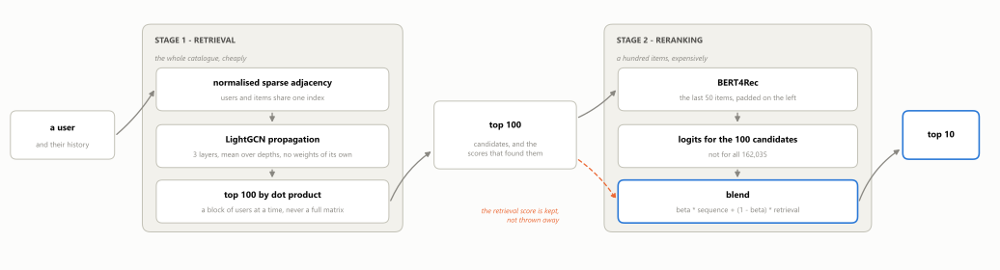

# Two-Stage Hybrid Recommender

[](https://github.com/no0e/two-stage-recommender/actions/workflows/tests.yml)
[](https://www.python.org/downloads/)
[](LICENSE)

Predicting the next item a user will buy. Retrieve a hundred candidates with a
graph, rerank them with a sequence model, on Amazon Reviews 2023 at two
catalogue sizes: 25,612 items and 162,035.

Built for an in-class Kaggle competition on a private Amazon dataset, where it
finished first of eighty. This is the rewrite, on public Amazon data.

## What it does

<p align="center">
  
</p>

**Retrieval** narrows the catalogue to 100 candidates. Users and items share one
index in a normalised sparse adjacency; LightGCN smooths embeddings over it,
three layers averaged, with no weights beyond the embedding table itself. The
top hundred come out of a dot product taken a block of users at a time, so no
users-by-items array is ever built.

**Reranking** orders those 100 with BERT4Rec over the user's last fifty items,
blended with the retrieval score rather than replacing it.

beta is how much of the final order the sequence model sets. It was fitted
separately on each category, against models that never saw a test target, and
came out at **0.75 both times**, with recall falling again at 1.0, where the
score that found the candidates is discarded.

## Results

Recall@10 over 20,000 held-out users per category, leave-one-out: the last item
of each user is the target and everything before it trains.

| | Video Games | Toys and Games |
|---|---|---|
| Items | 25,612 | 162,035 |
| Users | 94,762 | 432,264 |
| Most popular | 0.0240 | 0.0050 |
| BERT4Rec alone | 0.0683 | 0.0249 |
| LightGCN alone | 0.0668 | 0.0221 |
| **Two-stage** | **0.0860** | **0.0295** |

Margins are a paired bootstrap over users, 2000 resamples. Two stages beat the
graph alone by **+0.0192** [+0.0160, +0.0223] on Video Games and **+0.0075**
[+0.0058, +0.0093] on Toys and Games; they beat the sequence model alone by
+0.0177 and +0.0046. Every interval clears zero.

Neither stage is enough by itself, and which of the two is stronger alone
changes with the catalogue. That is the case for keeping both.

## Run it

```bash
pip install -r requirements.txt
python scripts/recommend.py                       # ten items for one user
python scripts/evaluate.py --category Video_Games # the full table
```

The data downloads itself: the 5-core benchmark files are public, 13 MB for
Video Games and 62 MB for Toys and Games.

`recommend.py` has to train the retrieval stage before it can answer (a few
minutes on a GPU, longer on a CPU), then caches the embeddings under `data/`,
so every run after the first is immediate. `--rerank` adds the second stage.
Items come out as their ASIN and a product link: the 5-core files carry
interactions, not names.

`evaluate.py` trains both stages twice, once on a validation split to fit beta and
once for the test. Video Games takes about an hour on one 15 GB GPU and Toys
and Games about four. Both write `docs/amazon_<category>.json`, and the second
run redraws the figure from the pair. `scripts/overnight.sh` runs them in
order.

## Serving

The two stages behind an HTTP endpoint, with no PyTorch in the serving image.

```bash
pip install -r requirements.txt -r requirements-dev.txt
python scripts/export_serving.py --category Toys_and_Games --precision fp16 --compile
CATEGORY=Toys_and_Games docker compose up --build          # API + Redis + loader
locust -f loadtest/locustfile.py --host http://localhost:8000
```

`export_serving.py` trains both stages and writes the reranker's candidate-scoring path as an ONNX graph, then checks it against PyTorch on 200 real users before anything is served: the fp32 graph agrees to 8·10⁻⁶ and gives the same top 10 for every one of them. An int8 copy (weights of MatMul and Gather quantized) is written too, and rejected: it keeps the top 10 for only 66% of users on Toys and Games, so the service picks the fp32 graph on its own, from the parity it recorded.

`recsys/serving/app.py` is an async FastAPI service. A request reads the user's history and embedding from Redis in one pipelined round trip (or from memory, where there is no Redis), retrieves 100 candidates with a numpy dot product over the item table, scores them with ONNX Runtime in the thread pool and blends the two scores with the fitted beta. Users the graph never saw get the popularity fallback.

Load test with Locust, 64 concurrent users, on one 72-core machine ([docs/serving_benchmark.json](docs/serving_benchmark.json)):

| Catalogue | Workers | Requests/s | p50 | p99 | Failures |
|---|---|---|---|---|---|
| Toys and Games, 162,036 items | 8 | 959 | 61 ms | 140 ms | 0 of 114,272 |
| Toys and Games | 16 | 1,033 | 47 ms | 170 ms | 0 |
| Video Games, 25,612 items | 8 | 2,276 | 25 ms | 48 ms | 0 |

One ONNX Runtime thread per worker is what makes those numbers. The runtime's default of a thread per core, times four workers, oversubscribed the machine: 9.6 requests per second and a 13 s p99 on the small catalogue.

`deploy/cloudrun.sh` builds the image with Cloud Build and deploys it to Cloud Run with the artifacts baked in.

## Training efficiency

The reranker's training step runs under fp16 autocast with a gradient scaler and `torch.compile`, measured by `scripts/benchmark_training.py` at the size of Toys and Games (162,036 items, batch 1,024, 2,048 sampled negatives) on a Tesla T4 ([docs/training_benchmark.json](docs/training_benchmark.json)):

| | samples/s | step | peak memory |
|---|---|---|---|
| fp32 | 8,237 | 124 ms | 3,569 MiB |
| fp16 | 10,429 | 98 ms | 2,846 MiB |
| fp32 + compile | 10,344 | 99 ms | 2,686 MiB |
| **fp16 + compile** | **16,679** | **61 ms** | **1,784 MiB** |
| bf16 + compile | 6,085 | 168 ms | 3,067 MiB |

Twice the throughput at half the memory. bf16 is slower than fp32 here because a T4 has no bf16 tensor cores; on an Ampere card it is the one to pick.

## Layout

```
recsys/data.py       the split, and the padding-safe index
recsys/amazon.py     the categories, and prefixes held as offsets
recsys/models.py     LightGCN and BERT4Rec
recsys/large.py      blocked retrieval, candidate-only reranking
recsys/metrics.py    recall, NDCG, coverage, paired bootstrap
recsys/serving/      ONNX export, numpy + ONNX Runtime ranking, Redis store, FastAPI
scripts/             recommend, evaluate, export_serving, benchmark_training, ...
loadtest/            the Locust scenario
deploy/              Cloud Run (Cloud Build + gcloud run deploy)
tests/               39 tests, no download and no GPU needed
notebooks/           the competition notebook (modelling part)
```

Nothing here builds a users-by-items array. Retrieval multiplies a block of
users against the item table and takes the top hundred before releasing the
block. Reranking computes 100 columns per user rather than 162,035 (the full
logits for one evaluation would be 13 GB that nothing reads), and training
samples its softmax for the same reason. Prefixes of a history are two offsets
into one shared array, not a list each, because the prefixes of a history of
length *n* hold *n(n+1)/2* integers between them.

`torch_geometric` is not a dependency. LightGCN propagation is one normalised
sparse matrix multiply per layer, so a graph library would have bought a single
line and cost an install that frequently fails.

## Licence

MIT, see [LICENSE](LICENSE). The Amazon Reviews 2023 data belongs to the
McAuley lab at UCSD and carries its own terms.
